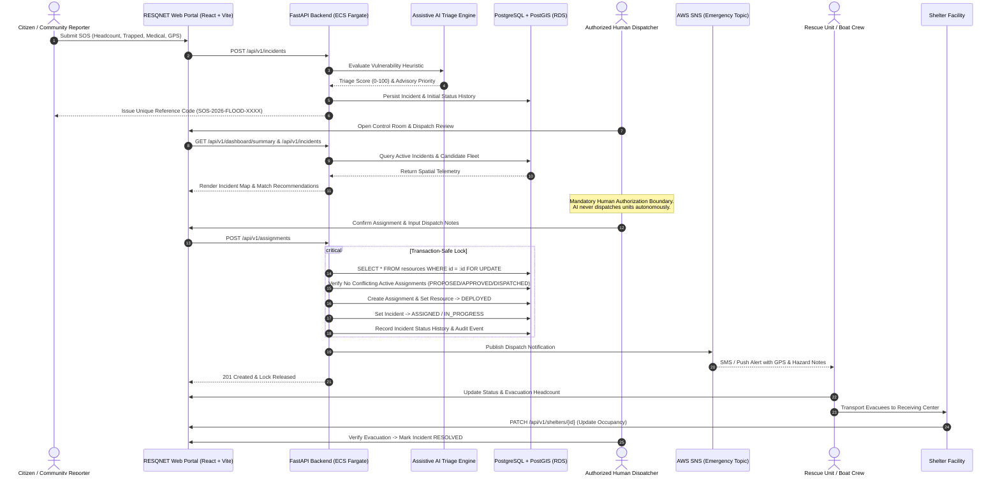
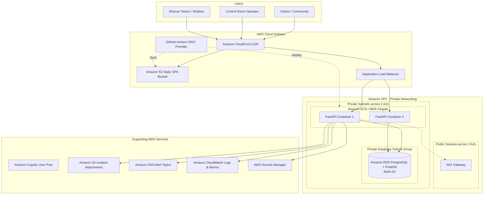

# RESQNET — Architecture & System Design

RESQNET is an intelligent disaster relief coordination and resource management ecosystem designed to unite citizens, multi-agency rescue teams, NGOs, shelters, and authorized control-room dispatchers during major catastrophe events.

The initial operational scenario is a **simulated flood response** in an urban river basin, engineered to generalize across future disaster types such as cyclones, landslides, heatwaves, and structural emergencies.

---

## 1. Core Architectural Workflow

---

## 2. Safety & Governance Principles

1. **Human-in-the-Loop Dispatch**:
   AI algorithms evaluate water level depths, trapped status, infant/elderly vulnerabilities, and proximity. However, **AI is strictly advisory**. The platform requires an authorized human dispatcher with role-level credentials to approve every vehicle dispatch, evacuation route, or medical assignment.
2. **Transaction-Safe Fleet Locking**:
   To prevent race conditions where two operators dispatch the same boat or medical truck simultaneously, backend assignment operations execute inside a database transaction with row-level locks (`SELECT ... FOR UPDATE`). Conflicting active assignments are rejected with HTTP 409 Conflict.
3. **Auditability**:
   Every state transition across incidents, assignments, and capacity updates produces immutable records in `incident_status_history` and `audit_events`, capturing timestamps, previous/new states, notes, and the actor's user identifier.
4. **Synthetic Data Integrity**:
   Demonstration datasets use fictional coordinates, simulated phone numbers (555-xxx), and fictional basin names to ensure no confusion with real-world 911/emergency facilities.

---

## 3. Technology Stack & AWS Topology

---

## 4. Key Database Schema Entities

* **`DisasterEvent`**: Declaration date, disaster type (flood, cyclone, landslide, etc.), status, severity, boundary polygon.
* **`Incident`**: Citizen SOS ticket, reference code, headcount, trapped count, medical assistance urgent toggle, PostGIS geometry point, AI advisory score, status history relationship.
* **`Resource`**: Boats, trucks, ambulances, drones; operational capacity, battery/fuel status, crew lead, current PostGIS coordinates.
* **`ResourceAssignment`**: Transaction-safe linkage between incident and resource, status lifecycle (`proposed`, `approved`, `dispatched`, `completed`, `cancelled`), dispatcher notes, timestamps.
* **`Shelter`**: Facility capacity, live occupancy, available beds, backup generator status, water purification capacity, medical post indicator.
* **`AuditEvent`**: Detailed event log of every critical system modification.
